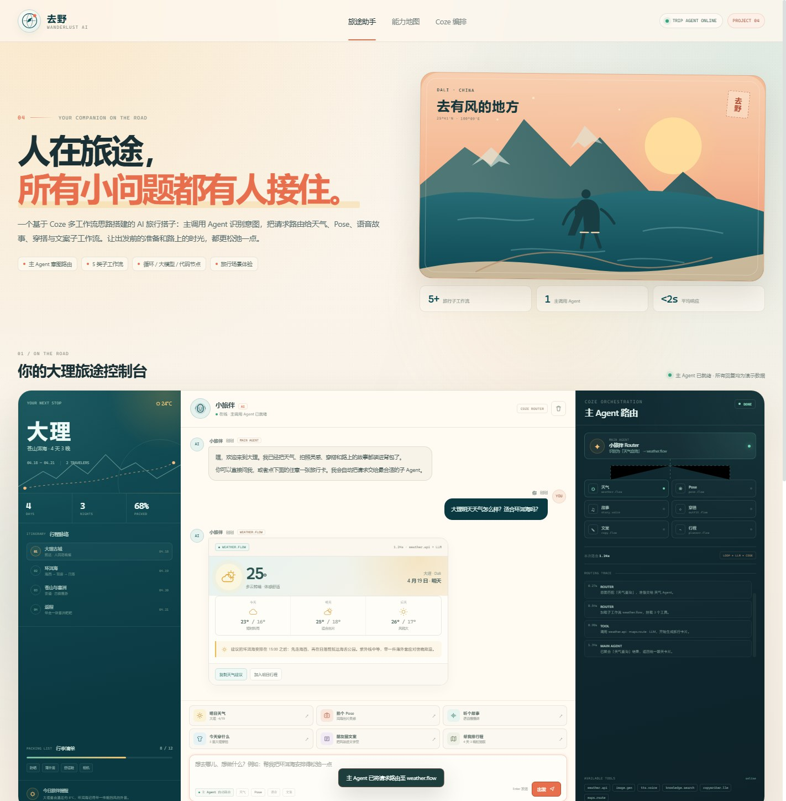

# 去野 · 人在旅途 AI 小助手 Demo

一个基于 Coze 多工作流思路搭建的 AI 旅行搭子交互式 Demo。主调用 Agent 负责识别用户意图，将请求路由到天气、Pose、语音故事、穿搭、朋友圈文案和行程规划等工作流，再把结果统一返回成聊天卡片。

> 在线体验：**https://carrotrain4.github.io/travel-ai-assistant-demo/**
>
> 本页面为可交互前端原型：主 Agent 路由、子工作流与工具调用由浏览器内状态机模拟，TTS 使用浏览器 Web Speech API。所有天气、地点、价格和行程信息均为虚构演示数据。



## 可以体验什么

- **主 Agent 意图路由**
  - 输入一句自然语言，自动匹配到对应子工作流
  - 右侧实时展示意图识别、工具挂载、子工作流执行和结果聚合轨迹
- **5+ 条旅行工作流**
  - 天气与出行节奏
  - Pose 与出片灵感
  - 语音故事陪伴
  - 场景化穿搭
  - 朋友圈文案
  - 松弛感行程规划
- **真实浏览器能力**
  - 语音故事使用浏览器 Web Speech API 朗读
  - 朋友圈文案可切换治愈 / 文艺 / 搞怪三种语气，一键复制
  - 行程、穿搭、天气建议都可以复制
- **旅行卡片**
  - 实时天气卡、三日预报和环洱海建议
  - 三种 SVG 旅行构图 Pose 卡片，可一键换 Pose
  - 三套早晚温差穿搭，可加入行李清单
  - 四天三晚低强度行程单

## Demo 中的主工作流

```text
用户一句话
   ↓
主调用 Agent（意图识别 + 当前行程上下文）
   ├── weather.flow   → weather.api / maps.route
   ├── pose.flow      → image.gen / code / vision
   ├── story.flow     → knowledge.search / LLM / TTS
   ├── outfit.flow    → weather.api / knowledge.search / LLM
   ├── copy.flow      → LLM / loop / copywriter
   └── planner.flow   → maps.route / weather.api / code / LLM
   ↓
统一旅行卡片 + 路由轨迹
```

## Coze 搭建思路

- **主调用 Agent**：先做意图识别与参数抽取，再决定调用哪个子工作流。
- **子工作流隔离**：每类能力独立编排，便于调试和复用。
- **节点能力**：使用大模型节点生成内容，代码节点处理格式与结构化结果，循环节点生成多套文案，插件节点接入天气 / 地图 / 图像 / 语音能力。
- **统一响应协议**：不同子工作流最后都返回可被聊天界面消费的卡片结构。

## 本地运行

```bash
python -m http.server 8000
```

访问 `http://localhost:8000/`。无需构建，无第三方前端依赖。

## 文件结构

```text
.
├── index.html          # 旅行工作台、能力地图与 Coze 架构
├── styles.css          # 响应式视觉、SVG 插画与动态卡片
├── app.js              # 意图路由状态机、旅行卡片与语音交互
├── favicon.svg
├── preview.jpg
├── .nojekyll
└── README.md
```

## 实现边界

- 页面内置六套演示回答，按照关键词进行前端意图路由。
- 天气、Pose、行程等信息为虚构数据，不会调用真实外部 API。
- 语音仅为浏览器本地朗读，播放能力取决于浏览器对 Web Speech API 的支持。
- 生产版本可将本页面中的意图协议接入 Coze API 或自建 Agent 服务，把前端模拟卡片替换为真实工作流返回。

---

AI 应用开发作品集 · Project 04 · 2026
